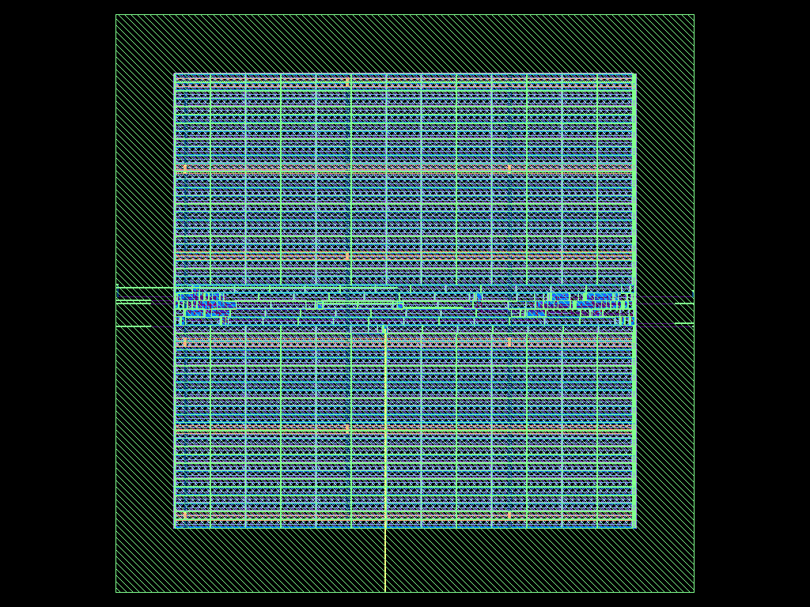

# Engineering workspace implementation report

This is an incremental development implementation based on 1.1.1, not completion
of the entire Chipflow 2.0 specification. No stable major release or signoff
qualification is declared. The per-requirement completion matrix is
[ENGINEERING_TRACKER.md](ENGINEERING_TRACKER.md). It distinguishes implemented,
partial, missing and blocked work rather than treating code presence as acceptance.

## Implemented scope

The integrated workspace adds evidence-based learning/standard/expert quality
policies; final-report timing/router checks; advisory SDC inventory and explicit
user-assumption SDC generation; environment manifests and retry mismatch policies;
restricted digest-pinned execution; real Icarus/Verilator/Cocotb adapters; Verilator
lint; Yosys equivalence; structured verification results; native GDS/netlist checks;
real layout rendering; safe bounded source import; maintained-library VCD parsing;
JSON/Markdown/HTML reports; compatibility-aware comparisons; bounded sequential
experiments and Pareto analysis; actionable log diagnostics; resource sampling;
user-wide physical-job serialization; and browser interactions with actual data.

Native ORFS remains the implementation engine. Existing snapshots, backup/restore,
1.x YAML defaults, detached workers, cancellation and local host/origin boundaries
are preserved. See [architecture and migration](ENGINEERING_ARCHITECTURE.md),
[CLI](ENGINEERING_CLI.md) and the focused guides linked there.

## Test evidence

Host: Debian 13 x86-64, Python 3.12.14, approximately 3 available CPUs, 9.7 GiB RAM.
The acceptance environment uses an isolated manager virtual environment and real
upstream EDA executables. Commands below assume those binaries are on PATH.

| Command / evidence | Result | Classification |
| --- | --- | --- |
| `python -m pytest -q` | 312 passed, 1 skipped, 0 failed; 60.11 seconds at recorded integration checkpoint | Mixed unit/application doubles and real integrations; not 312 engineering proofs |
| `pytest -q tests/test_verification_adapters.py tests/test_reference_designs.py` | Real Icarus/Verilator/Cocotb/Yosys positive and negative cases passed; source boundary additions also passed | Passed with real tools for native cases; application parser tests separately |
| `pytest -q tests/test_inspection_physical.py` | 30 passed after distro-Yosys compatibility fix | Real KLayout/Yosys inspection plus application/deck-plan parser tests; no foundry verification |
| `pytest -q tests/test_workspace_security.py` | 11 passed | Real Icarus strict retry and real guardian delayed-cleanup process tests; other API/path/parser application tests |
| `python tests/browser_smoke.py` | Passed | Real Chromium, Icarus, learning/expert, retry/cancel and narrow viewport |
| `python tests/browser_workspace.py` | Passed | Real Chromium import/save/standard simulation, waveform search/zoom/cursors, reports, layout image loading; geometric viewer fixture is not an implementation flow |
| Opt-in real Docker integration in `test_execution_provenance.py` | Real counter compile/sim/VCD, Yosys synthesis and orphan cleanup passed | Passed with real tools and restricted container; default suite skips this without explicitly supplied image/mount |
| `ruff check chipflow tests scripts`; `ruff format --check chipflow tests scripts`; `node --check chipflow/static/app.js` | Passed | Static checks |
| `python -m build`; `twine check dist/*`; `python scripts/check_distribution.py dist` | Passed at checkpoint | Packaging checks |
| `python scripts/wheel_smoke.py dist/*.whl --require-sim` | Clean install, bundled demo, simulation and installed dashboard passed | Real wheel install and Icarus |
| `python -m pip_audit -r requirements-runtime.txt` | No known vulnerabilities found | Runtime dependency audit; not an absence-of-vulnerabilities proof |

A final fully provisioned run found an onboarding test depended on a host having
missing tools. Its environment was isolated to an explicitly missing ORFS path
without changing its assertions. Hosted native CI also exposed an older Yosys
`tee -o` filename-quoting difference; a fixed relative report name preserves all
structural checks and the focused 30-test inspection suite passed after correction.

One warning is an upstream Starlette/httpx deprecation. Browser testing used the
installed Chromium executable; Firefox/WebKit and ARM/macOS hosts are unqualified.
Hosted GitHub Actions execution is separate from the recorded local results.

The Docker acceptance used Ubuntu pinned at
`sha256:68ee22004a9109b44973313b02ff7b1de250f1de0f5ecb628d73f579aaff33ac`
and an explicit read-only upstream OSS CAD Suite mount. The image alone does not
contain the EDA suite. Executable identities and mount inputs remain important.
Full physical execution in that container has not been qualified.

## Engineering validation

Counter native run: `b3fe6a972fc44cbc8f73facec9da838c`, stored locally under
`.chipflow/acceptance/current/runs/b3fe6a972fc44cbc8f73facec9da838c/`.
Raw generated results are excluded from source distributions; do not mistake a
checked-in summary for the underlying EDA evidence.

| Check | Actual result and scope |
| --- | --- |
| RTL verification | Real self-checking Icarus simulation passed before physical implementation |
| Synthesis / implementation | Real Yosys and ORFS synthesis, floorplan, placement, CTS, routing and finish completed |
| Setup / hold slack | 9.69676 ns / 0.0855032 ns from final native report |
| Setup / hold TNS | 0 / 0 in native report |
| Router DRC | 0 reported violations; router scope only |
| Cell area | 111.986 square micrometers in native report |
| Power | 1.32757e-05 W native estimate; no measured/activity-qualified power claim |
| Standard quality | Passed the recorded required checks; optional checks remain unknown/not-run |
| Constraint completeness | Unknown; generated clock-only SDC is simplified, missing interface assumptions require review |
| Formal equivalence | Not run for this physical counter acceptance |
| Mapped-netlist structural inspection | Unsupported without explicitly declared technology models; file/stage checks still executed |
| Qualified DRC / LVS / antenna | Not executed: qualified decks and matching analysis environment unavailable |
| GDS | Real KLayout parsed expected top `counter`, 34 hierarchy cells, 22 layers, 100 by 100 micrometer bounding box |
| GDS identity | 174104 bytes; SHA-256 `cab41ca9b567b0a5185fde417a47648a914ce59cfe1639fe1132bf2f257eb6eb` |

Artifacts relative to that run directory: `results/nangate45/counter/base/6_final.gds`,
`results/nangate45/counter/base/6_final.odb`, `waveform.vcd`,
`logs/nangate45/counter/base/6_report.json`, `logs/nangate45/counter/base/5_2_route.json`,
`inspection-gds.json`, `layout-preview.png`, `layout-preview.json`,
`environment-manifest.json`, `quality.json`, `constraints.json` and `console.log`.

ORFS revision: `1ff305ccbe694958d0125f0695dceefb58dfb3f6`, Nangate45 platform.
Yosys reports 0.68+post. OpenROAD's supplied binary reports `unknown`; its SHA-256
`0a4cdf08482bab2d99543e8b32b4b142e013becc7f2c1598afb39ba058193f53`
is recorded instead of inventing a version. GDS generation used actual KLayout
0.30.0 CLI; inspection/rendering used KLayout Python 0.30.12. The manifest records
other executable/platform/input identities and the actual development source state.

FIFO, multiclock and tiny-CPU reference designs passed real RTL self-checks,
waveform generation and Yosys synthesis. Their CLI simulation artifacts are under
`/workspace/chipflow-reference-cli/` in this execution environment. They are small
application references, not comprehensive processor/CDC/SRAM qualification.
All three also completed real native implementation after the original missing
floorplan setup was corrected with documented 100 by 100 micrometer reference
geometry. Clock periods and RTL were preserved. Initial floorplan failures remain
recorded in `.chipflow/acceptance/current/extended-before-floorplan-fix.json`.

| Design | Run ID | Setup / hold slack (ns) | Setup / hold TNS | Router DRC | Native GDS |
| --- | --- | --- | --- | --- | --- |
| FIFO | `061279ffd5ee43b8a59f4645b2381380` | 9.65254 / 0.0975722 | 0 / 0 | 0 | Passed, top fifo |
| Tiny CPU | `ba833774d4b64965a130ab281c894c8a` | 9.48321 / 0.115506 | 0 / 0 | 0 | Passed, top tiny_cpu |
| Multiclock | `37c6d3db11514d999a0fae35d1d90c5d` | 9.71365 / 0.0856582 | 0 / 0 | 0 | Passed, top multiclock |

Each run lives under `.chipflow/acceptance/current/runs/RUN_ID/` and records the
same artifact categories and environment manifest as the counter. These runs have
simplified interface constraints and do not establish CDC safety or complete
endpoint coverage. All four mapped netlists additionally passed independent real
Yosys hierarchy/structural checking with explicit Nangate45 Liberty interfaces;
that post-run evidence is `independent-netlist-inspection.json`, not a retroactive
modification of original managed run results.

The deliberately impossible 0.001 ns counter target (`03d86d86074349b098cb8b833ae48376`) completed tool execution but correctly failed quality: setup slack -0.265937 ns and setup TNS -1.94579 ns. Its original baseline was preserved, and no constraints were relaxed to hide the failure.

An explicit-input native STA fixture also passed real setup/hold/TNS reports and
reported actual missing-I/O/unconstrained warnings for clock-only constraints.
An impossible clock produces negative slack/TNS; bad SDC fails. The single-corner
fixture had setup 8.918490410 ns and hold 0.075438075 ns, with no SPEF (cell delays
only). Default-activity power 5.350414654e-7 W is an estimate, not measured power.
The independent fixture evidence directory is `/tmp/chipflow-native-sta-current/analysis/`.
Optional SPEF/VCD/SAIF input paths exist but their annotations remain unqualified.

Exact dual-channel AXI DMA/Sky130 inputs and macro/SRAM technology views were not
available, so those acceptance categories remain unexecuted. Functional gate
acceptance on this host is blocked by unavailable complete cell behavioral models;
a strict Liberty conversion failed on an unsupported clock-gate model. No ignore
flags or incomplete models were used to claim a pass.

## User experience and independent review

Beginner onboarding retains explicit installation choices and real self-checking
counter simulation. Standard import requires source ordering and top selection;
new standard projects save a real standard quality policy. Expert copies preserve
advanced settings. Browser results expose unknown checks and report downloads;
waveforms use bounded event data and layout previews come from native artifacts.
The full-feature wave viewer, a native layout editor and complete guided timing
coverage are outside the shipped scope.

Independent review found and fixed false-positive pass-marker matches, generated
SDC strict-retry identity changes, stale compatibility evidence on worker failure,
container cleanup being killed before its budget, malformed VCD server errors,
and FIFO/symlink source-import hazards. New regression tests exercise those paths.
See [SECURITY_REVIEW.md](SECURITY_REVIEW.md) for trust boundaries and remaining risks.

An application-only benchmark with 1000 saved runs, an 8 MiB log and 10 samples
recorded startup median 217 ms, history API median 184 ms and log API median
3.49 ms (p95 approximately 308/276/9.77 ms). This is synthetic manager-load evidence,
not a large-design, long-duration, cache or container-overhead qualification.

## Remaining limitations and readiness

Not implemented: safe stage cache, general parallel DAG/priority scheduler, secure
remote workers, commercial simulator adapters, qualified CDC/RDC, SDF timing
simulation, functional coverage collection, comprehensive activity-aware power,
PDF export, full interactive PPA charts, and a universal plugin SDK. Experiments
run sequentially with bounded inputs; no global optimization claim is made.
Physical-check plans exist but real qualified deck execution remains unvalidated.
Untrusted native projects are not sandboxed. Full WCAG, multiple-browser,
large-design, power-loss/disk-exhaustion and platform qualification remain incomplete.

Educational use: supported reference workflows have real evidence, with the stated
constraints and tooling. Personal projects and repeated experiments: useful within
the tested trusted-local Linux/toolchain scope; users must review constraints and
quality requirements. Professional production workflows: not broadly qualified by
these tests. Qualified physical signoff: not established. Completing a native GDS
flow and router checks is insufficient to change that conclusion.
