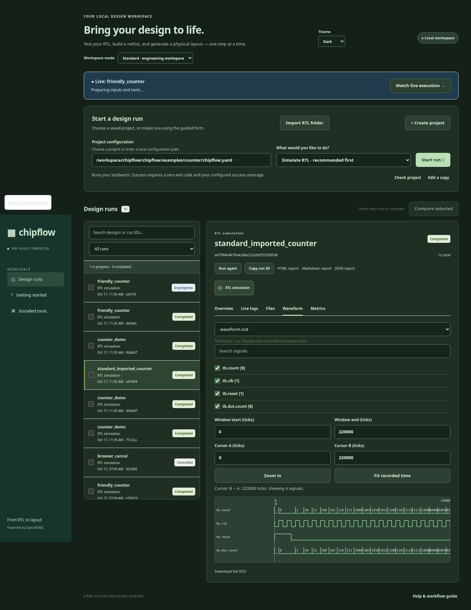

# Browser engineering workspace

Start `chipflow serve --port 8080` and open its printed localhost URL. The browser
uses the same local project files and run store as the CLI. Closing the browser
does not cancel workers.

The workspace selector changes presentation only. Learning shows the guided
counter journey. Standard concentrates on project runs and engineering evidence.
Expert additionally exposes complete YAML editing. Switching modes never rewrites existing project settings. A newly created project
in Standard mode receives the standard quality policy, including its verification
requirements; the guided form explains this before saving. Existing projects keep
their configured policy when edited as a copy. Use Expert YAML editing to explicitly
change a project's quality policy or required checks. The guided editor saves a new configuration copy and
preserves advanced fields from an existing project.

Choose System, Light, or Dark in the theme selector. Preferences persist locally
in the browser. Run selections also appear in the URL for reopening results.

## Importing existing RTL

Choose **Import RTL folder** and enter a directory on the server's computer.
Discovery lists candidate sources and module declarations; it is not a Verilog
compiler. Select the intended source files and explicitly select a top module.
Choose **Review selected sources** to open the project form. Review source order
in its source textarea, configure include folders, move testbench files into the
separate testbench field, and provide the actual clock/constraint assumptions.
The import does not guess a testbench, source dependency order, or timing intent.
Run **Check project**, then run simulation before physical implementation.

## Inspecting execution and engineering quality

The execution badge answers whether requested tools completed. The separate
Engineering quality table shows recorded policy, required checks, statuses,
values, thresholds and evidence. Missing evaluation on an older run is displayed
as not evaluated. Missing evidence is never a pass. A successful physical command
or generated GDS does not establish timing closure or foundry signoff.

Select a pipeline stage to inspect its actual execution record and saved outputs.
Stage output records and stage-numbered native files are linked for download;
these are not reconstructed layout previews. Pending or failed stages may have
no saved artifacts. The full run log remains available from the stage dialog.

Live logs support text search, warning/error filtering, pause/follow, and download.
Severity is a case-insensitive textual filter over tool output, not an authoritative
EDA diagnostic classifier. The browser retains a bounded recent log window; use
the downloaded full log to inspect older output.

HTML, Markdown and JSON report links export recorded run evidence. Reports for
active runs are provisional. Open the native reports when interpreting constraints,
metrics, routing violations, verification scope, or tool warnings.

## Waveforms and layout

Download a VCD from Overview or Files and open it in a local maintained viewer,
for example `gtkwave /path/to/waveform.vcd`. Download GDS and open it in KLayout.
The Waveform tab reads actual saved VCD data through the maintained pyvcd parser.
Choose a saved waveform, search and select up to 16 signals, adjust the time window,
zoom, fit the recorded time range, and set two measurement cursors. Times are
simulation ticks with the recorded timescale shown explicitly. Scalar signals use
step traces; buses retain their recorded value strings. Unknown values remain
unknown. File, signal, and event limits protect the browser; a limited preview is
marked and the original VCD remains downloadable. This is a bounded inspection
viewer, not a full replacement for GTKWave. When a run contains `layout-preview.png`, Overview, Files and the finishing-stage
dialog display the saved native KLayout rendering. The accompanying
`layout-preview.json` records the renderer, top cell and source identity. The image
is generated from actual GDS geometry; it is not a DRC/LVS result or an embedded
layout editor. If no native image exists, no preview is shown. Interactive native
layout editing is not implemented.

## Browser regression checks

With a local server running on port 8088:

```sh
CHIPFLOW_URL=http://127.0.0.1:8088 python tests/browser_workspace.py
```

The additional browser regression creates a real counter simulation, tests mode
and theme persistence, imports its real source directory, inspects recorded stage
artifacts and reports, inspects real waveform signal traces and cursor/zoom controls, exercises log filtering, and checks narrow-screen overflow.
It requires Playwright, Chromium and working Icarus binaries. The broader existing
`tests/browser_smoke.py` covers learning, advanced configuration preservation,
retry and real cancellation. Test doubles for presentation states must be reported
separately from native tool execution.

## Recorded browser example



Captured from the local Chromium acceptance journey with a real Icarus counter waveform. This screenshot establishes the viewer interaction, not physical implementation or signoff.

VCD aliases sharing an identifier are coalesced to the first declaration in the
bounded workspace view. Download the original trace for complete alias browsing
or traces beyond the displayed limits. Truncated previews do not establish that
later simulation events were absent.
